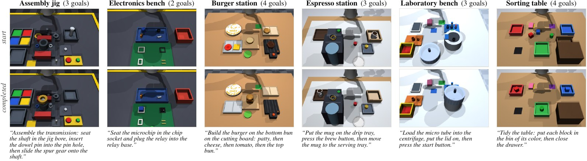
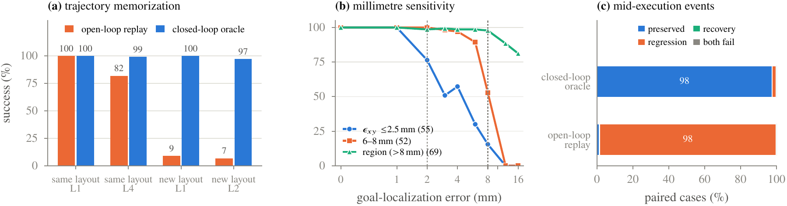

# PLUMB-Bench: A Physically Verified Benchmark for Precise, Generalizable Robot Manipulation

[](https://www.python.org/downloads/)
[](https://mujoco.org/)
[](LICENSE)

**Yeungnam University** &middot; **Physical Superintelligence**

**Project page:** [physical-super-intelligence.github.io/PLUMB_Bench](https://physical-super-intelligence.github.io/PLUMB_Bench/)



**PLUMB-Bench** is a MuJoCo benchmark of **210 instruction-accurate manipulation tasks in seven domains**, from shaft
seating and electronics assembly to burger building, espresso service, and centrifuge loading. Every instruction
compiles to an ordered conjunction of physical goal predicates (343 goals), and a placement counts only when the body
is **released, supported, at rest, and within 2–8 mm** of a goal pose calibrated by letting the body settle in its
target, or wholly inside its target region. A five-level hierarchy shifts layout, appearance, friction, and mass on
paired seeds, and matched Base/Dynamic rollouts displace objects mid-execution. A privileged closed-loop oracle
certifies every condition (95.6–99.9% over 6,300 episodes), and random and null policies solve none of 5,040.

## What counts as success

| Condition | Requirement |
| :--- | :--- |
| Released | no finger touches the body |
| Supported | a non-robot body carries it, after it was lifted at least 2 cm |
| At rest | linear speed < 0.02 m/s and angular speed < 0.2 rad/s |
| Upright | tilt at most 5° on precision workcells, 15° elsewhere |
| On target | within ε<sub>xy</sub> of the settled goal pose (2 mm on precision workcells, 8 mm elsewhere, 6 mm for two loose fits), or the whole footprint inside a target region |

Goals are ordered: a goal counts only when it becomes true after every goal ordered before it, so a button pressed too
early or a part already in place does not count. Besides placements (`On`), goals can require a latching button
pressed (`Pressed`), a drawer or vise jaw closed (`Closed`), a body slid without lifting (`Slid`), a body held above a
target (`HeldOver`), a hover or touch held for consecutive steps (`GripperAbove`, `Touching`), or a body raised
(`Lifted`).

Goal poses are not set by hand: when a task is built, every goal body is lowered into its target and simulated to rest,
and the settled pose becomes the goal pose (a drift of more than 5 mm rejects the task). There is no attachment,
snapping, or teleport; grasping is frictional and force-limited, so every goal is physically attainable by
construction.

## Tasks

| Domain | Workcells | Example instruction | Goals per task | Tolerance (mm / °) |
| :--- | :--- | :--- | :---: | :---: |
| D1 Industrial | assembly jig, electronics | "Seat the transmission shaft in the jig bore." | 1 | 2 / 5 |
| D2 Culinary | burger, espresso | "Crown the burger: put the top bun on the tomato slice." | 1 | 8 / 15 |
| D3 Domestic | sorting table | "Stack the green cylinder on the red block." | 1–2 | 8 / 15 |
| D4 Laboratory | laboratory bench | "Put the lid on the centrifuge." | 1 | 2 / 5 |
| D5 Long-horizon | five workcells | "Build the burger on the bottom bun on the cutting board: patty, then cheese, then tomato, then the top bun." | 2–5 | 2–8 / 5–15 |
| D6 Precision chain | jig, electronics, lab | "Seat the shaft in the jig bore, slide the bearing ring over it, then close the vise jaw." | 2–4 | 2 / 5 |
| D7 Service chain | burger, espresso, sorting | "Put the mug on the drip tray, press the brew button, then put the mug on the saucer." | 2–6 | 8 / 15 |

Each domain has 30 tasks. A simulated Franka Panda acts with 7-D delta actions (TCP increment, yaw, gripper) at 20 Hz;
observations are a workcell RGB view (640×660), a wrist RGB view (300×420), optional depth, and proprioception. The
step budget is 400 steps for one goal plus 250 per further goal.

## Distribution shift

Suites are paired on seeds, so a change in success measures the shift rather than a new scene.

| Level | `--suites` name | What changes |
| :--- | :--- | :--- |
| L1 Nominal | `nominal` | starts uniform in each object's region; initial TCP jittered by ±1.5 cm |
| L2 Spatial | `p2_spatial` | region starts moved by 7–12 cm outside the L1 support, yaw 45–90° |
| L3 Visual | `p3_visual` | light intensity ×0.5–1.5, light positions ±0.5 m |
| Color | `p1_object` | colors of the moved objects ±25% |
| L4 Physical | `p4_physical` | sliding friction μ ~ U(0.12, 0.25) on moved objects and finger pads; mass and inertia ×1.8–2.5 |
| L5 Compound | `combined_ood` | L2, L3, L4, and color jointly |

**Mid-execution events.** Following LIBERO-MAX, a Base rollout and a Dynamic rollout share the task, seed, initial
state, and executed action prefix; when the hand first arrives above the event body, the Dynamic rollout displaces it
by 3 cm along ±x or ±y at rest and hands control back to the policy. Outcomes are preserved success, regression,
recovery, or persistent failure; we report the paired change ΔSR and the conditional regression rate CRR.

## Validation

Oracle success (%) over all 210 tasks, 5 episodes per task and condition, with 95% task-bootstrap intervals:

| Condition | Oracle | Random | Null |
| :--- | :---: | :---: | :---: |
| L1 Nominal | 99.9 [99.7, 100.0] | 0 / 630 | 0 / 210 |
| L3 Visual | 99.9 [99.7, 100.0] | 0 / 630 | 0 / 210 |
| Color | 99.9 [99.7, 100.0] | 0 / 630 | 0 / 210 |
| L4 Physical | 98.9 [98.1, 99.5] | 0 / 630 | 0 / 210 |
| L2 Spatial | 97.7 [96.4, 98.9] | 0 / 630 | 0 / 210 |
| L5 Compound | 95.6 [94.0, 97.1] | 0 / 630 | 0 / 210 |

Three probes show that success requires closed-loop precision rather than recall:

- **Trajectory memorization.** Open-loop replay of a successful oracle trajectory reproduces all 629 episodes on the
  same seed, but succeeds in 8.9% of new layouts from the same nominal distribution (oracle: 100%) and in 81.8% when
  only friction and mass change on the same layout (oracle: 99.0%).
- **Millimetre sensitivity.** Offsetting the oracle's goal estimate by 3 mm halves success on the 55 tasks whose
  tightest goal allows 2 mm (50.9%); both point tiers reach 0% at 12 mm.
- **Mid-execution events.** Over 921 matched 3 cm displacements on 154 tasks, the oracle keeps 97.5% Dynamic success
  (CRR 2.4%), while continuing the Base actions open loop keeps 1.4% (CRR 98.6%).



## Quick start

```bash
git clone https://github.com/Physical-Super-Intelligence/PLUMB_Bench.git
cd PLUMB_Bench
python -m venv .venv && source .venv/bin/activate    # Windows: .venv\Scripts\activate
pip install -e .
```

The Python package is `afford_pro`; `afford_pro.make` builds any of the 210 tasks:

```python
import numpy as np
import afford_pro

env = afford_pro.make("industrial_shaft_assembly")
obs, info = env.reset(seed=0)
print(env.language_instruction)        # Seat the transmission shaft in the jig bore.
obs, reward, terminated, truncated, info = env.step(np.zeros(7))
```

Reference policies, data, and analysis:

```bash
# Oracle on one task across all paired suites (episodes.csv and summary.json in --out-dir)
python scripts/evaluate_policy_suite.py --policy oracle --task industrial_shaft_assembly --episodes 5 \
    --suites nominal,p2_spatial,p3_visual,p1_object,p4_physical,combined_ood --out-dir results/oracle

# Random and null floors use --policy random / --policy null

# Generate validated oracle demonstrations (robomimic HDF5) and check every episode, replaying some
python scripts/generate_all_210_tasks.py --domain industrial --num-demos 50
python scripts/validate_datasets.py --replay-per-file 2 --out-dir results/dataset_validation

# Export to LeRobot or RLDS
python scripts/convert_to_lerobot.py --hdf5 datasets/*.hdf5 --out lerobot/
python scripts/convert_to_rlds.py --hdf5 datasets/*.hdf5 --out rlds/ --format npz

# Diagnostic probes of the paper: replay, localization, events, pairing
python -I scripts/diagnostic_probes.py events --tasks 1-30 --workers 8 --out results/probe_events.json
```

## Evaluation protocol for learned policies

Train on 50 oracle demonstrations per task and evaluate 50 episodes per task and condition on seeds disjoint from data
generation (`scripts/evaluate_policy_suite.py --checkpoint ...`), plus the 921 event pairs. Report success rate with
95% task-bootstrap intervals, goal completion, the physical robustness index PRI = SR(shifted) / SR(L1), ΔSR and CRR
for events, and the peak contact force on the robot as logged telemetry. `scripts/train_policy.py` trains
behavior-cloning and diffusion-policy baselines on the generated data.

## Repository layout

| Path | Contents |
| :--- | :--- |
| `afford_pro/bench/` | task specifications, goal predicates, multi-goal environment, privileged oracle, instructions |
| `afford_pro/datasets/` | HDF5 writer, generation, episode validation, replay, LeRobot/RLDS converters |
| `afford_pro/evaluation/` | rollouts and statistics (Wilson and task-bootstrap intervals) |
| `scripts/` | evaluation, data generation and validation, probes, training |
| `index.html`, `assets/` | project page (GitHub Pages builds from the repository root) |
| `docs/` | dataset card, roadmap and evidence |

`benchmark/`, `scripts/evaluate_paired_dynamic.py`, and `afford_pro/dynamic_suite.py` belong to the earlier
single-body task set (`task_set="legacy"`), which is deprecated; the event protocol above is implemented in
`scripts/diagnostic_probes.py events`.

## Citation

```bibtex
@misc{sarowar2026plumbbench,
  title  = {PLUMB-Bench: A Physically Verified Benchmark for Precise, Generalizable Robot Manipulation},
  author = {Sarowar, Selim and Physical Superintelligence Research Team},
  year   = {2026},
  url    = {https://github.com/Physical-Super-Intelligence/PLUMB_Bench}
}
```

## License

[MIT](LICENSE). Robot and scene assets derived from MuJoCo Menagerie keep their own licenses; see
`afford_pro/assets/robots/NOTICE.md`.
